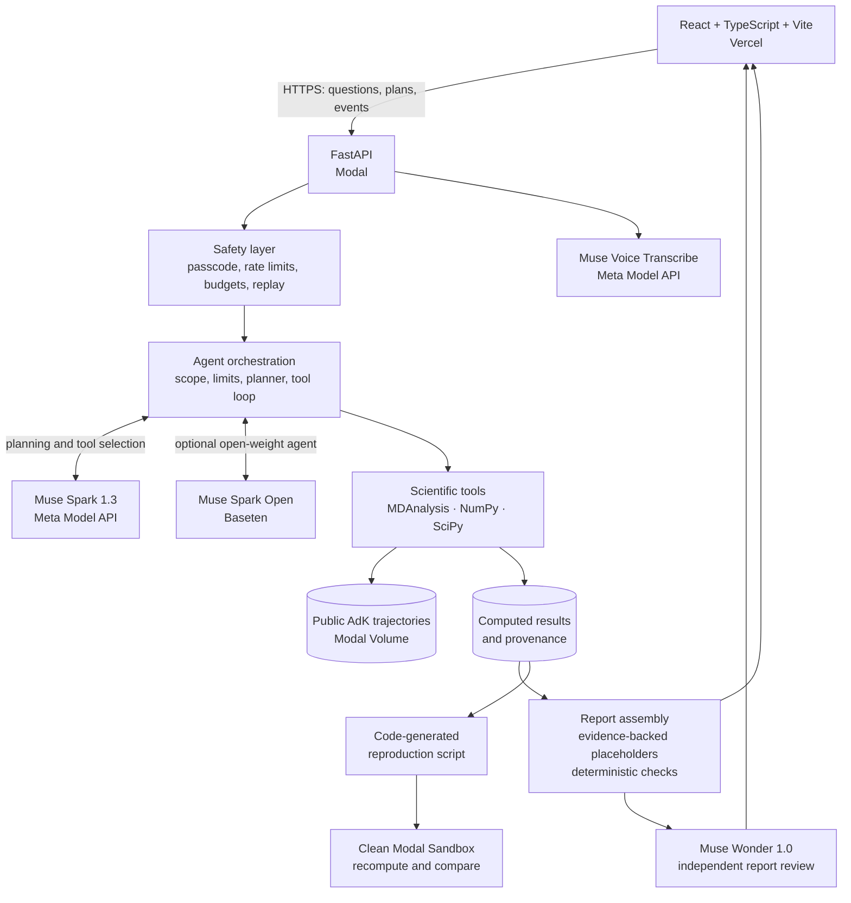

# TrajectoryGPT

**An AI research copilot for molecular dynamics — with computations you can inspect and reproduce.**

[Live application](https://trajectorygpt.vercel.app/) · [Source code](https://github.com/amehta2025/TrajectoryGPT)

TrajectoryGPT turns questions about molecular simulations and figures from scientific publications into executable investigations. Instead of asking a language model to calculate scientific results, it uses **Muse Spark** to plan and select analysis tools, **MDAnalysis and NumPy/SciPy** to perform the calculations, and a separate **Muse Wonder** verifier to inspect the resulting report and supporting evidence.

The current demo studies *E. coli* adenylate kinase (AdK) using two public trajectories: an equilibrium simulation and a biased closed-to-open transition path. The application also supports interpreting uploaded scientific figures, reproducing supported analyses, and transferring applicable methods to its available data. It is **not yet a general bring-your-own-trajectory platform**.

## What you can do

- **Ask questions in plain language or by voice.** Muse Voice Transcribe turns push-to-talk audio into editable text; it does not automatically submit a question.
- **Review an investigation before it runs.** The model proposes a plan of up to five steps. The backend validates the proposed tools, dataset, ranges, and parameters, and the user approves the plan.
- **Inspect molecular interactions.** Explore residue contacts, distances, changes in contact frequency, protein flexibility, and domain motion using interactive charts and an NGL-based 3D structure viewer.
- **Reproduce a scientific figure.** Upload a supported figure, review extracted assumptions, and compare a newly computed result with the reference. The interface distinguishes *exact reproduction* from *method transfer*; applying a published method to different data is not presented as a numerical match.
- **Examine the evidence behind findings.** Findings link back to computed tool results, with statistical limitations and scientific settings available in detail.
- **Export and rerun.** Generate a standalone Python reproduction script from the recorded tool calls and scientific code. A separate Modal Sandbox can execute it and compare recomputed values with the saved investigation.

## Architecture



The boundary between the **agent** and the **science layer** is intentional. Muse selects from approved tools and explains results; it does not supply arbitrary measurements to the scientific outputs. The report generator uses placeholders for measured values and resolves them from stored computation results. Deterministic checks assess evidence references, statistical support, and unsupported claims before the report is accepted. A second model then reviews the accepted report against the evidence and plots; its verification status can also be *flagged* or *unavailable*, not only *verified*.

### Application layers

| Layer | Main source | Responsibility |
| --- | --- | --- |
| Frontend | [`frontend/src/`](frontend/src/) | React interface, plan approval, streamed execution trace, Plotly charts, NGL structure viewer, voice input, figure comparison, exports |
| HTTP API | [`backend/app/main.py`](backend/app/main.py) | FastAPI routes, request validation, structured results, run events, and integration with the backend layers |
| Safety | [`backend/app/safety/`](backend/app/safety/) | Demo passcode, per-session/per-IP rate limits, usage budget, recorded-run fallback |
| Agent | [`backend/app/agent/`](backend/app/agent/) | Scope and residue checks, planning, tool selection, model providers, sessions, report generation, verification, figure parsing, voice transcription |
| Science | [`backend/app/science/`](backend/app/science/) | Contact maps, distance traces, native-contact fractions, flexibility, opening metrics, statistical inference |
| Provenance | [`backend/app/provenance/`](backend/app/provenance/) | Stored computation inputs and values, generated reproduction scripts, plots, sandbox checks |
| Deployment | [`backend/modal_app.py`](backend/modal_app.py) | Modal application, persistent volume, secrets, API concurrency, optional warm container, sandbox support |

### A question, end to end

1. **Input and gating.** A user enters a question, speaks into the microphone, or uploads a figure. Live AI routes enforce access controls and usage limits. Scope checks reject unsupported or nonsensical requests, while deterministic limits catch impossible residue names and out-of-range requests.
2. **Plan and approval.** Muse Spark (or Muse Spark Open through Baseten) proposes a validated plan. Parameters that need review can be confirmed or adjusted before execution.
3. **Tool-driven investigation.** The agent chooses an allowed tool, the backend checks its arguments against the approved plan, and the scientific function computes its result. The model receives a concise tool summary and may choose the next operation. The UI streams progress as the investigation runs.
4. **Evidence-backed report.** Stored results carry identifiers used by the report's placeholders. Backend code substitutes the actual values and rejects unsupported evidence references and overclaims; a code-generated fallback is available.
5. **Independent review.** Muse Wonder evaluates the report against the recorded results and generated plots. The UI displays its verdict, including concerns or a check that could not finish.
6. **Reproducibility.** Optionally download the generated script or request an independent run inside a clean Modal Sandbox.

## Scientific data and safeguards

| Dataset | Source and purpose | Statistical treatment |
| --- | --- | --- |
| `adk_equilibrium` | ~1.004 μs unbiased equilibrium trajectory of apo AdK, distributed through MDAnalysisData | Contact comparisons can use autocorrelation-aware effective sample sizes, block-bootstrap uncertainty estimates, multiple-testing correction, and cutoff robustness checks, subject to data-sufficiency checks |
| `adk_transition` | 98-frame biased closed-to-open path distributed with MDAnalysisTests | Descriptive analysis only. Frames are **path steps, not equal time intervals**; autocorrelation-derived confidence intervals and equilibrium time-series significance tests are refused |

Domain definitions follow published *E. coli* AdK numbering: NMP = residues 30–59, LID = 122–159, and CORE = 1–29, 60–121, and 160–214. See [`config/dataset.yaml`](config/dataset.yaml) for citations, units, and data-handling details.

For equilibrium contact comparisons, the science layer includes autocorrelation and effective sample size calculations, block-bootstrap estimates, Benjamini–Hochberg false-discovery-rate adjustment, and robustness checks at multiple distance cutoffs. These tests are not interpreted as causal evidence. The transition-path dataset deliberately refuses unsupported statistical inference.

### Figure interpretation and validation

The figure pipeline validates uploads and extracts a structured specification, including analysis type, dataset, protein, atom selections, thresholds, references, and axis definitions. It records confidence and source information so uncertain assumptions can be reviewed. A supported **exact reproduction** is checked against the original computational method; a **method transfer** applies an appropriate analysis to the available dataset without claiming the numbers should match the publication.

For the MDAnalysis User Guide native-contact example, [`backend/app/science/native_contacts.py`](backend/app/science/native_contacts.py) compares its output against `MDAnalysis.analysis.contacts.q1q2` and reports the maximum absolute difference across both reference-contact series. The reference calculation uses Cα atoms, an 8 Å native-contact radius, and the first and last transition frames. This **8 Å native-contact radius** is a separate analysis parameter from the **4.5 Å default heavy-atom contact cutoff** used in other contact analyses.

An additional figure-axis mapping check is implemented in [`backend/scripts/iyer_axis_mapping.py`](backend/scripts/iyer_axis_mapping.py) for Iyer et al. (2020), Fig. 5C. It relates the figure's alignment positions to *E. coli* AdK residues using the referenced closed and open PDB structures. Source figure credits and usage terms appear in [`assets/figures/ATTRIBUTION.md`](assets/figures/ATTRIBUTION.md).

## Model roles

| Model | Provider | Role |
| --- | --- | --- |
| Muse Spark 1.3 | Meta Model API | Question interpretation, analysis plans, tool selection, report wording, figure extraction |
| Muse Spark Open | Baseten | Alternative open-weight model for the planning and agent loop |
| Muse Wonder 1.0 | Meta Model API | Independent post-report review against results and plots |
| Muse Voice Transcribe | Meta Model API | Push-to-talk transcription to editable text |

Both agent providers share the same validated tools and scientific computations. Model-generated wording remains subject to backend evidence checks. Usage and estimated cost are tracked; the Baseten cost display uses an estimate rather than a verified provider invoice.

## Access controls and recorded investigations

Live AI operations are protected by a demo passcode, per-session and per-IP rate limits, and a configurable daily usage budget. Keys are stored server-side in Modal Secrets. The backend can switch into **replay mode** explicitly (`APP_MODE=replay`) or when its tracked daily AI budget is exhausted.

The repository contains **five curated investigation records** in [`backend/replay/`](backend/replay/). These are **interactive replays, not videos**: saved plans, tool results, reports, and verification outcomes are presented through the same interface, while already-computed charts and molecular structures remain inspectable. The replay path is designed not to make new model calls. Access to a replay is not a claim that a new live investigation was run.

The default Modal deployment may scale to zero when idle; setting `WARM=1` during deployment keeps a container available for lower cold-start latency. The deployment uses a single concurrent API container to preserve in-memory run state and streaming events.

## Reproducibility

The provenance layer stores the executed tool calls, parameter values, recorded results, and dataset fingerprints associated with a run. The exported script is assembled by application code rather than generated freely by the language model. It bundles the necessary scientific modules and dataset configuration, recomputes the recorded calls, and compares reproduced values with those saved by the original investigation.

A Modal Sandbox check runs the export in an isolated container using pinned science-library versions and the dataset on the shared volume. **One recorded validation reported 602 of 602 stored values matching**; this is an example result, not a blanket guarantee for every investigation. The script and sandbox check let researchers audit results separately from the agent's narrative.

## Running locally

**Requirements:** Python 3.12, Node.js/npm, and credentials for the model providers you plan to use. The first scientific-data request may download substantial public trajectory data.

```bash
# From the repository root
python -m venv .venv
source .venv/bin/activate  # Windows PowerShell: .venv\Scripts\Activate.ps1
pip install -r backend/requirements.txt

cp .env.example .env   # configure API credentials and optional settings
cd backend
uvicorn app.main:app --reload
```

In another terminal:

```bash
cd frontend
npm ci
npm run dev
```

The development UI is served at `http://localhost:5173`. The frontend defaults to `http://localhost:8000` for its API. Set `VITE_API_URL` in the frontend environment if your backend runs elsewhere. Ensure server-side model credentials are supplied to the backend process. For Modal deployment, see [`backend/modal_app.py`](backend/modal_app.py); the application requires the configured Modal Secrets and its persistent volume.

### Tests and development checks

```bash
cd backend
python -m pytest -q

# Frontend (from frontend/)
npm run build
npm run lint
npx vitest run
```

The repository contains backend `pytest` tests across science, agent, safety, reporting, verification, export, and API behavior, plus frontend Vitest tests for application state. Dataset-dependent tests can involve large downloads; [`backend/pytest.ini`](backend/pytest.ini) defines a `slow` marker. See [`notes/redteam.md`](notes/redteam.md) for adversarial-testing notes and [`notes/calibration/`](notes/calibration/) for statistical calibration artifacts. Test totals evolve as the project changes, so use the current test runner output rather than a fixed count.

## Limitations

- **Fixed datasets.** The demo currently works with the two configured adenylate kinase trajectories. General-purpose user trajectory uploads are future work.
- **Supported figures only.** Figure recognition and scientific method transfer are bounded by supported analysis types, available datasets, and the information actually shown in a figure or its accompanying source.
- **One approved parameter set per plan.** Dataset, domain groups, cutoffs, windows, stride, and sequence exclusion are shared across plan steps. Tool calls cannot silently override those approved settings, although they may select permissible per-call details such as a residue pair.
- **Scientific uncertainty remains.** The statistical checks apply to eligible equilibrium data and do not establish causality. The biased transition path is treated descriptively.
- **Verification can flag or fail.** A second-model review is an additional check, not a formal proof of correctness. Reproducibility tests confirm numerical consistency with recorded computations, not the validity of every scientific assumption.
- **Protected live execution.** Running live AI investigations requires configured keys and demo access; replay mode offers a narrower prerecorded experience without new model inference.

## References and attribution

The example simulations and scientific figures belong to their original authors and distributions. Refer to [`config/dataset.yaml`](config/dataset.yaml) and [`assets/figures/ATTRIBUTION.md`](assets/figures/ATTRIBUTION.md) for exact citations and licensing details.

- Seyler, S. & Beckstein, O. (2017), *Molecular dynamics trajectory for benchmarking MDAnalysis*. [figshare](https://doi.org/10.6084/m9.figshare.5108170.v1).
- Beckstein, O., Denning, E. J., Perilla, J. R. & Woolf, T. B. (2009), *Zipping and unzipping of adenylate kinase: atomistic insights into the ensemble of open↔closed transitions*. [Journal of Molecular Biology](https://doi.org/10.1016/j.jmb.2009.09.009).
- [MDAnalysis](https://www.mdanalysis.org/) and its [contacts analysis documentation](https://docs.mdanalysis.org/stable/documentation_pages/analysis/contacts.html).
